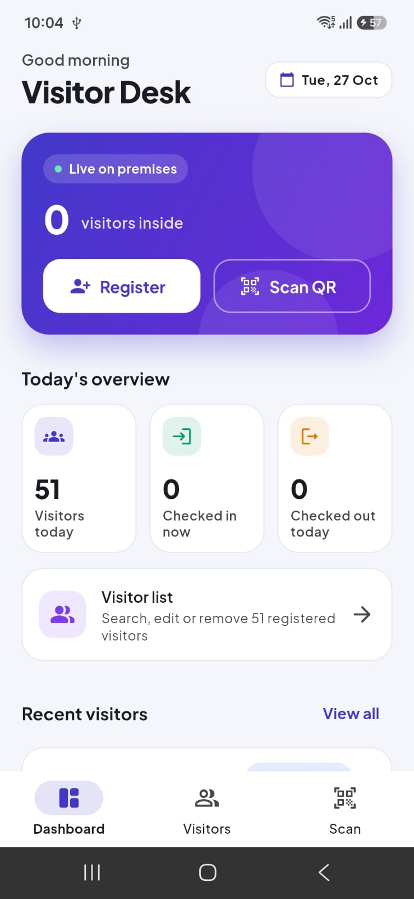
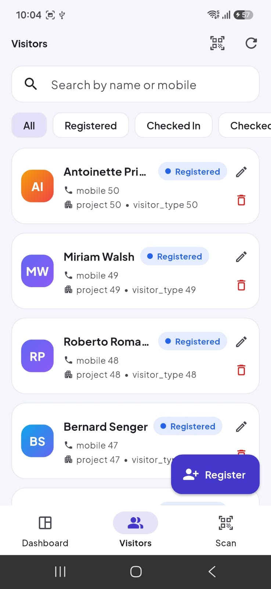
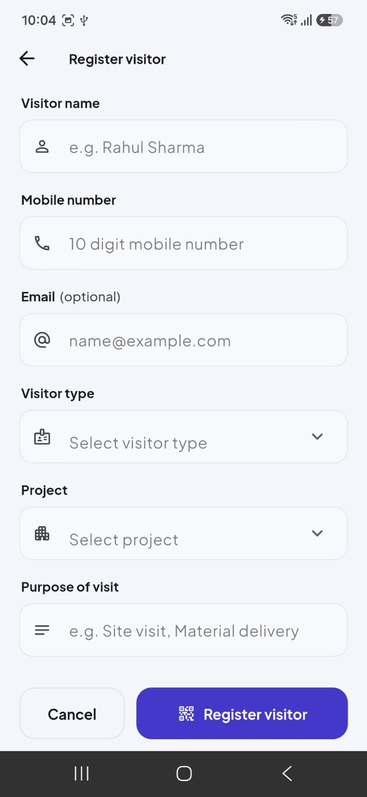
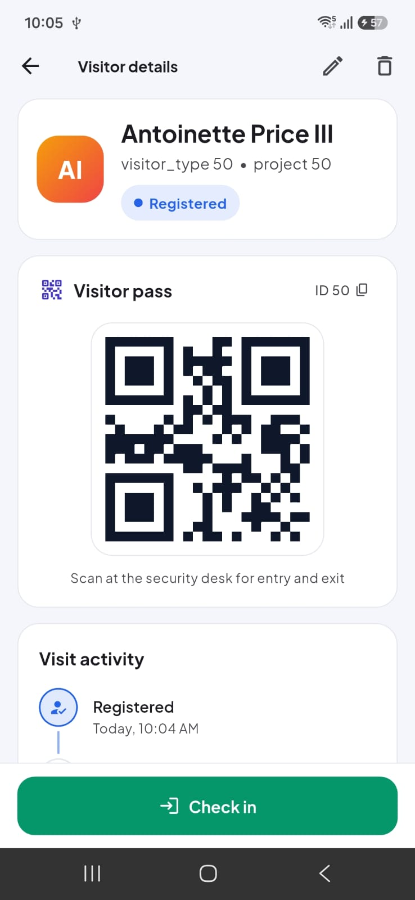

# Visitor Desk – Visitor Management App

A Flutter Android app for front-desk and security staff at residential project sites. Staff can register visitors, manage visitor records, issue a QR pass, scan passes at the gate and record check-in / check-out. All data is stored in a mock REST API (MockAPI), so records persist across app restarts.

## Quick reference

| | |
|---|---|
| Platform | Android |
| Flutter | 3.35.3 (stable) |
| Dart | 3.9 |
| State management | Provider |
| API base URL | `https://6ae023e78e42963c8d5eed1b.mockapi.io/api/v1` |
| APK | `build/app/outputs/flutter-apk/app-release.apk` (also shared with the submission) |

## Screenshots

<table>
  <tr>
    <th>Dashboard</th>
    <th>Visitor List</th>
    <th>Visitor Registration</th>
  </tr>
  <tr>
    <td></td>
    <td></td>
    <td></td>
  </tr>
  <tr>
    <th>Visitor Details &amp; QR Code</th>
    <th></th>
    <th></th>
  </tr>
  <tr>
    <td></td>
    <td></td>
    <td></td>
  </tr>
</table>

## Features

### Dashboard
- Total visitors registered today, visitors currently checked in, visitors checked out today.
- Counts are calculated from the records returned by the API (no separate dashboard API) using the device's local date.
- Shortcuts to Register Visitor, Visitor List and Scan QR.
- The Visitors tab shows a badge with the number of visitors currently inside.

### Visitor registration and editing
- Fields: name, mobile, email, visitor type, project, purpose of visit.
- Validation: name and purpose required, mobile exactly 10 digits (digits only), email optional but validated when entered, type and project must be selected.
- New visitors are saved through the API with status `Registered`.
- After saving, a confirmation is shown and the app opens the visitor's details with the QR pass generated from the ID returned by the API.
- The same form is used to edit an existing visitor.

### Visitor list and management
- Scrollable list showing name, mobile, project, visitor type and status.
- Search by name or mobile number (local search on the loaded records).
- Filter by status, pull to refresh.
- Tap to view details, edit, and delete with a confirmation dialog.

### QR code generation and scanning
- QR pass shown on the Visitor Details screen, containing the server-generated visitor ID.
- Scanner opens the camera, reads the QR, extracts the visitor ID, fetches the visitor from the API and opens their details with the current status and the allowed action.
- Errors for invalid QR codes and for visitors that don't exist.
- Repeated scanner callbacks are ignored while a scan is being handled, so one QR only triggers one lookup.
- Torch toggle, scan window and a clear message when camera permission is denied.

### Check-in / check-out
- Status flow: `Registered → Checked In → Checked Out`.
- Check-in only when `Registered`; check-out only when `Checked In`; completed visits can't be checked in again.
- Check-in and check-out times are recorded and saved through the API.
- The list, details screen and dashboard counts update immediately after a status change.

### UI states
Loading (skeleton loaders), success messages, empty list, network failure with retry, form validation errors, invalid QR, and check-in / check-out failures are all handled without blank screens or crashes.

### Bonus features implemented
- Filter visitors by status
- Pull to refresh
- Visit activity timeline (registered, checked in, checked out)
- Unit and widget tests
- Dark mode (follows the system setting)

## Packages

| Package | Version | Used for |
|---|---|---|
| provider | 6.1.5+1 | State management |
| http | 1.6.0 | REST API calls |
| qr_flutter | 4.1.0 | QR code generation |
| mobile_scanner | 7.4.2 | QR scanning with the camera |
| intl | 0.20.3 | Date and time formatting |
| flutter_lints | 5.0.0 | Lint rules (dev) |

Font: Plus Jakarta Sans, bundled in `assets/fonts` (SIL Open Font License).

## Project structure

```
lib/
  main.dart                 App entry, Provider setup, theme
  core/                     API config, exceptions, validators, date and QR helpers, snackbars/dialogs
  models/                   Visitor, VisitorDraft, VisitorStatus (incl. status transition rules)
  services/                 VisitorRepository interface and ApiVisitorRepository (http)
  providers/                VisitorProvider, the single source of truth for visitor data
  screens/
    home_shell.dart         Bottom navigation (Dashboard, Visitors, Scan)
    dashboard/              Dashboard screen
    visitors/               Visitor list screen
    visitor_form/           Register / edit screen
    visitor_details/        Details, QR pass, check-in / check-out
    scanner/                QR scanner screen
  theme/                    ThemeData, colours, status colours
  widgets/                  Reusable UI: AppTextField, AppDropdownField, AppButton, StatCard,
                            VisitorCard, StatusChip, VisitorAvatar, skeleton loaders,
                            empty and error state views
test/                       Model, status rule, validator, provider and widget tests
```

## State management

The app uses **Provider** with one `VisitorProvider` (a `ChangeNotifier`) placed above `MaterialApp`.

- It holds the visitor list, loading and error state, the search query and the status filter.
- Dashboard numbers (`visitorsToday`, `currentlyCheckedIn`, `checkedOutToday`) are getters calculated from the same list. When a visitor is checked in on the details screen, the list card, the dashboard counts and the navigation badge all update without a reload.
- Screens never call the API directly. They call provider methods, which use the `VisitorRepository` interface. This keeps HTTP code out of the widgets and lets the tests use an in-memory repository.

Provider was chosen because the app has one main data set with a few derived values. It keeps the code simple and readable at this size, while BLoC would add boilerplate without much benefit.

## Business rules and duplicate prevention

- Allowed transitions are defined in one place, `VisitorStatus.blockedReason()`, and return a readable message when an action isn't allowed.
- Before every check-in or check-out, the provider fetches the latest record from the API and validates the transition again. A stale screen or a second device can't check the same visitor in twice.
- While a visitor is being updated they are marked busy. The action button shows a loader and a second tap is rejected.
- The scanner uses `DetectionSpeed.noDuplicates` and also ignores detections while a scan is being handled, until the lookup finishes or the user taps **Scan again**.

## QR format

The QR pass contains `VMS:<visitorId>`, for example `VMS:12`, where the ID is the one generated by MockAPI. The `VMS:` prefix lets the scanner reject unrelated QR codes as invalid before calling the API. A valid-looking code for an ID that doesn't exist shows "Visitor not found".

## REST API

### Base URL

```
https://6ae023e78e42963c8d5eed1b.mockapi.io/api/v1
```

The app is already configured with this URL in `lib/core/api_config.dart`. It can also be overridden at build time with `--dart-define=API_BASE_URL=...`.

### Endpoints

| Method | Endpoint | Used for |
|---|---|---|
| GET | `/visitors` | Load all visitors (list, search, dashboard counts) |
| GET | `/visitors/{id}` | Visitor details, QR lookup, re-check before status updates |
| POST | `/visitors` | Register visitor |
| PUT | `/visitors/{id}` | Edit visitor, check-in, check-out |
| DELETE | `/visitors/{id}` | Delete visitor |

Updates send the full record with PUT, so the status and timestamps are never lost whether the API merges or replaces the record.

### Visitor record

```json
{
  "id": "1",
  "name": "Rahul Sharma",
  "mobile": "9876543210",
  "email": "rahul@example.com",
  "visitor_type": "Customer",
  "project": "Project A",
  "purpose": "Site Visit",
  "status": "Registered",
  "created_at": "2026-10-26T10:00:00+05:30",
  "check_in_time": null,
  "check_out_time": null
}
```

Check-in sets `"status": "Checked In"` and `check_in_time`. Check-out sets `"status": "Checked Out"` and `check_out_time`. Timestamps are ISO 8601 with the device's UTC offset.

### Error handling

All API calls go through `ApiVisitorRepository`, which converts failures into readable messages: no internet, timeout (15 s), 404 not found, 429 rate limit, 5xx server errors, other HTTP errors, and invalid or unexpected JSON. The UI shows these as error states or snackbars and never crashes.

### Setting up your own MockAPI project (optional)

1. Create a project at [mockapi.io](https://mockapi.io) with the API prefix `/api/v1`.
2. Add a resource named `visitors` with these String fields: `name`, `mobile`, `email`, `visitor_type`, `project`, `purpose`, `status`, `created_at`, `check_in_time`, `check_out_time`.
3. Set the generated record count to 0.
4. Put the new base URL in `lib/core/api_config.dart` or pass it with `--dart-define`.

## Setup and running

Requirements: Flutter 3.35.3 or newer, Android SDK, an Android device or emulator (a physical device is recommended for the scanner).

From the project folder:

```bash
flutter pub get
flutter run
```

Build the release APK:

```bash
flutter build apk --release
```

The APK is created at `build/app/outputs/flutter-apk/app-release.apk`.

Run the tests:

```bash
flutter test
```

## Permissions

- `INTERNET` for API calls.
- `CAMERA` for QR scanning. If the permission is denied, the scanner explains how to enable it from system settings and offers a retry button.

## Known limitations

- One visit per registration. A returning visitor is registered again for a new visit, as allowed by the assignment scope.
- No offline cache. The app needs a network connection to load and update records.
- MockAPI's free plan has rate limits; very fast repeated actions can return HTTP 429, which the app shows as an error message.
- Designed for Android phones in portrait. Tablet layouts are not specially optimised.
